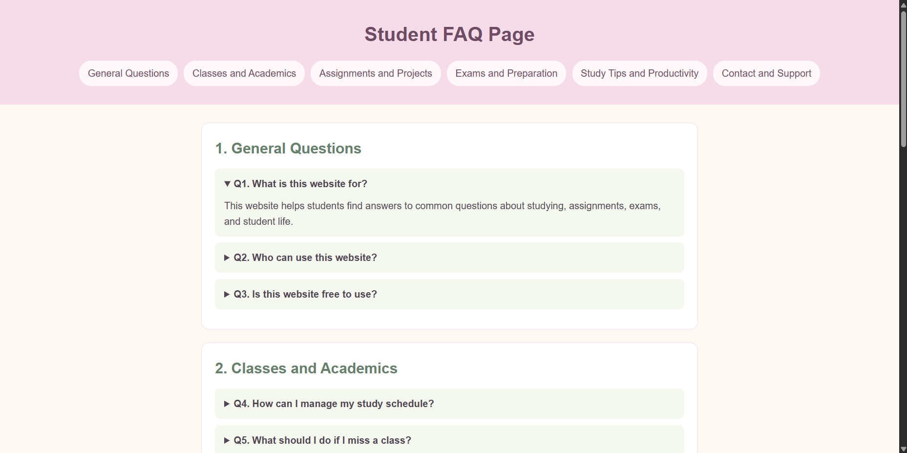

# Student FAQ Page

## What I learned

I built a simple student FAQ page to practise HTML and CSS. Along the way, I learned how to:

- Use HTML `
` and `
` to create expandable FAQ answers without JavaScript.
- Organise content into sections and link to them with navigation anchors.
- Style a page with basic CSS and use Flexbox to arrange a wrapping navigation menu.

To view the project, open `index.html` in a web browser.